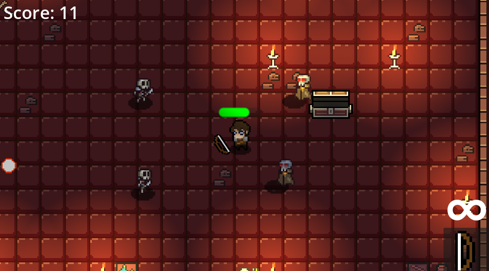
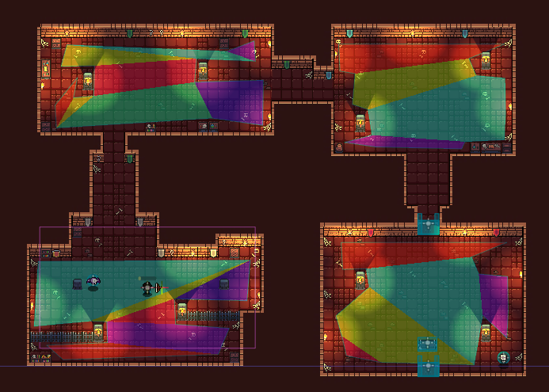
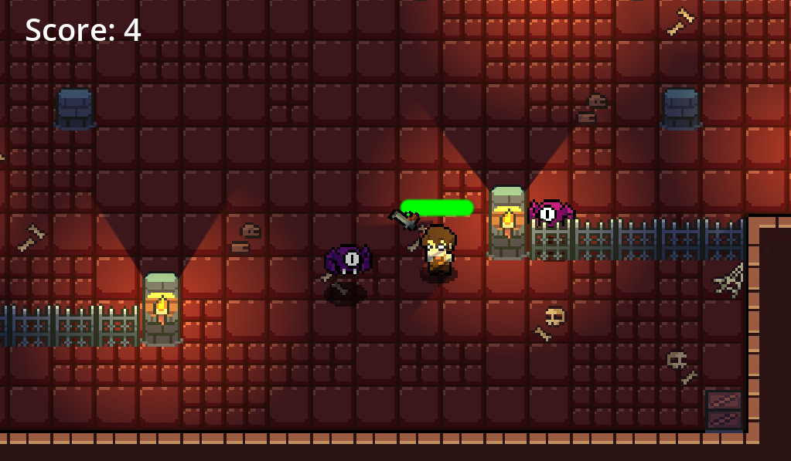
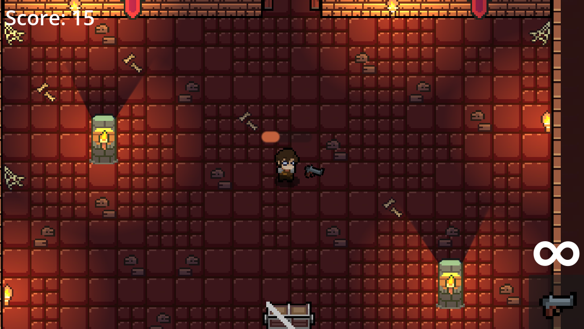

# 🎮 Bullet Dungeon

**Bullet Dungeon** es un videojuego 2D de **acción y disparos con perspectiva top-down**, desarrollado en **Godot 4.7** como proyecto académico del curso **Diseño y Desarrollo de Juegos Interactivos II**.

El jugador debe recorrer un dungeon, sobrevivir a grupos de enemigos, mejorar su arsenal, completar encuentros por oleadas y avanzar entre niveles. El proyecto está diseñado como una experiencia **single-player**.

<p align="center">
  
</p>

---

## 📸 Capturas del juego

| Vista general del dungeon | Combate e iluminación |
|---|---|
|  |  |

| Habitación iluminada | Nuevos enemigos |
|---|---|
|  |  |

> Las capturas corresponden a la versión actual del proyecto e incluyen iluminación dinámica, combate, score y distintos tipos de enemigos.

---

## 🕹️ Gameplay

La mecánica principal combina movimiento libre en 8 direcciones, combate a distancia, enemigos con distintos comportamientos y progresión entre habitaciones.

El flujo principal del juego es:

1. Explorar el dungeon.
2. Entrar a una zona de combate.
3. Enfrentar enemigos y oleadas.
4. Obtener puntuación al derrotarlos.
5. Abrir cofres y recoger nuevas armas.
6. Limpiar habitaciones para habilitar el avance.
7. Continuar al siguiente nivel conservando el progreso necesario del jugador.

---

## ✨ Características actuales

### Jugador

- Movimiento en **8 direcciones**.
- Sistema de vida con barra visual dinámica.
- Animaciones de `Idle`, `Walk` y `Hurt`.
- Orientación del sprite según la posición del mouse.
- Daño por contacto y ataques enemigos.
- Reinicio del nivel al perder toda la vida.

### Combate y armas

- Sistema de disparo dirigido con el mouse.
- **Pistola** como arma inicial.
- **Arco** desbloqueable mediante un ítem obtenido de un cofre.
- Cambio de arma usando la rueda del mouse.
- Persistencia de las armas obtenidas entre niveles mediante `GameState`.
- Proyectiles independientes para pistola y arco.

### Enemigos

El juego incluye distintos tipos de enemigos con comportamientos propios:

- **Bat Enemy**: persigue al jugador y dispara proyectiles periódicamente.
- **Skeleton Enemy**: enemigo utilizado en encuentros del dungeon.
- **Vampire**: enemigo cuerpo a cuerpo con persecución y ataque por proximidad.
- **Skeleton Scythe**: enemigo melee que reutiliza la lógica de estados con diferentes animaciones y presentación visual.

Los enemigos cuerpo a cuerpo utilizan una máquina de estados:

```text
IDLE → CHASE → ATTACK
          ↓
         HURT
          ↓
         DEAD
```

El comportamiento considera:

- Rango de detección.
- Rango de ataque.
- Cooldown entre ataques.
- Knockback al recibir daño.
- Frame específico de impacto dentro de la animación.
- Animaciones de movimiento, ataque, daño y muerte.

### Spawners y oleadas

El proyecto cuenta con dos sistemas principales para generar enemigos:

- **Spawner por área**: activa la aparición de enemigos cuando el jugador entra en una zona.
- **Wave Spawner**: administra encuentros divididos en varias oleadas.

El sistema de oleadas utiliza las fases:

```text
WAITING → COUNTDOWN → ACTIVE → DONE
```

La siguiente oleada comienza únicamente cuando todos los enemigos de la oleada actual han sido eliminados.

### Cofres, ítems y progresión

- Cofres con animación de apertura.
- Aparición de ítems al abrir un cofre.
- Desbloqueo del arco mediante `ItemBow`.
- Puertas que aparecen o se habilitan cuando se cumplen condiciones del nivel.
- Transición automática al siguiente nivel cuando se atraviesa una salida habilitada.
- Persistencia básica de:
  - Vida.
  - Score.
  - Armas obtenidas.
  - Arma seleccionada.

### Iluminación

Los niveles incorporan iluminación dinámica para reforzar la atmósfera del dungeon:

- `CanvasModulate` para controlar la iluminación general.
- `PointLight2D` para antorchas y fuentes de luz localizadas.
- Sombras activadas en las luces.
- Oclusión de luz mediante elementos del escenario.
- Diferentes zonas claras y oscuras para mejorar la lectura visual del nivel.

<p align="center">
  
</p>

---

## 🔊 Sistema de audio

El proyecto incorpora un sistema centralizado mediante un nodo **`AudioManager`** encargado de reproducir música y efectos de sonido globales.

### Audio global

El `AudioManager` administra:

- Música de fondo.
- Disparo de pistola.
- Disparo de arco.
- Recolección de ítems.

Ejemplo simplificado:

```gdscript
extends Node2D

func _ready() -> void:
    play_music()

func play_music():
    $Music.play()

func play_shoot_sound():
    $Shoot.play()

func play_shoot_bow_sound():
    $Bow.play()

func pickup_item():
    $pickupItem.play()
```

### Audio posicional

Para sonidos cuya intensidad depende de la distancia al jugador se utiliza **`AudioStreamPlayer2D`**.

Actualmente se aplica, por ejemplo, a:

- Aleteo de los murciélagos.
- Sonidos de ataque de enemigos cercanos.

Esto permite que el audio se escuche con mayor intensidad cuando la fuente está próxima al jugador y disminuya al alejarse.

---

## 🎛️ Controles

| Acción | Control |
|---|---|
| Moverse | `W A S D` o flechas |
| Apuntar | Movimiento del mouse |
| Disparar | Click izquierdo |
| Cambiar arma | Rueda del mouse |
| Abrir cofres / recoger objetos | Por proximidad / contacto |

---

## 🧠 Organización y patrones utilizados

El proyecto aplica diferentes enfoques para mantener la lógica separada y reutilizable.

### Factory / creación de enemigos

Los spawners trabajan con `PackedScene` y pueden instanciar diferentes enemigos sin depender directamente de una sola clase concreta.

```gdscript
var enemy = enemy_scene.instantiate()
get_parent().add_child(enemy)
```

### Observer / Signals

Las señales de Godot se utilizan para comunicar eventos entre componentes sin crear dependencias innecesarias.

Ejemplos:

- `enemy_died`
- `spawner_cleared`
- `wave_started`
- `body_entered`
- `animation_finished`

### State

Los enemigos melee utilizan una máquina de estados para controlar su comportamiento:

```gdscript
enum State { IDLE, CHASE, ATTACK, HURT, DEAD }
```

Esto evita mezclar persecución, ataque, daño y muerte dentro de una única lógica difícil de mantener.

---

## 🗂️ Estructura principal del proyecto

```text
BulletDungeon/
├── Assets/                 # Sprites, tiles, audio y otros recursos
├── Scenes/
│   ├── Level1.tscn
│   ├── Level2.tscn
│   ├── Level2Lights.tscn
│   ├── Level2Waves.tscn
│   ├── Player.tscn
│   ├── Gun.tscn
│   ├── Bow.tscn
│   ├── BatEnemy.tscn
│   ├── SkeletonEnemy.tscn
│   ├── Vampire.tscn
│   ├── Skeleton_scythe.tscn
│   ├── chest.tscn
│   └── Door.tscn
├── Scripts/
│   ├── player.gd
│   ├── weapon_manager.gd
│   ├── gun.gd
│   ├── bat_enemy.gd
│   ├── enemy_melee.gd
│   ├── spawner.gd
│   ├── wave_spawner.gd
│   ├── chest.gd
│   ├── door.gd
│   ├── item.gd
│   ├── score.gd
│   └── GameState.gd
├── project.godot
└── README.md
```

> La estructura puede ampliarse conforme se incorporen nuevos niveles, enemigos, sonidos y recursos.

---

## ⚙️ Requisitos

- **Godot Engine 4.7**.
- Proyecto configurado para renderizado **Forward Plus**.
- Mouse y teclado.

---

## 🚀 Ejecución local

1. Clonar o descargar el repositorio.
2. Abrir **Godot 4.7**.
3. Seleccionar **Import**.
4. Elegir el archivo:

```text
project.godot
```

5. Esperar a que Godot importe los assets.
6. Ejecutar el proyecto con **F6/F5** desde el editor.

---

## 🧩 Tecnologías utilizadas

- **Godot Engine 4.7**
- **GDScript**
- `CharacterBody2D`
- `Area2D`
- `CollisionShape2D` / `CollisionPolygon2D`
- `AnimatedSprite2D`
- `AnimationPlayer`
- `TileMapLayer`
- `PointLight2D`
- `CanvasModulate`
- `AudioStreamPlayer`
- `AudioStreamPlayer2D`
- Signals y Tweens de Godot

---

## 📌 Estado del proyecto

Bullet Dungeon se encuentra en desarrollo académico y actualmente dispone de:

- [x] Movimiento del jugador.
- [x] Sistema de vida y daño.
- [x] Pistola y arco.
- [x] Cambio y persistencia de armas.
- [x] Enemigos a distancia.
- [x] Enemigos cuerpo a cuerpo con máquina de estados.
- [x] Spawners por zonas.
- [x] Sistema de oleadas.
- [x] Score.
- [x] Cofres e ítems.
- [x] Transición entre niveles.
- [x] Iluminación dinámica.
- [x] Música de fondo.
- [x] Efectos de sonido de armas e ítems.
- [x] Audio posicional para enemigos.
- [x] Experiencia single-player.

---

## 👥 Equipo — Grupo 3

- **Ariza Rosas Sergio Antonio**
- **Jonathan Jesus Jacinto Badillo**
- **Roberto Alonso Mosquera Perales**

Proyecto desarrollado para el curso **Diseño y Desarrollo de Juegos Interactivos II**.

---

## 📄 Recursos externos

El proyecto utiliza recursos gráficos y de audio externos como apoyo para sprites, tiles, ambientación y efectos de sonido.

Las licencias y atribuciones correspondientes deben conservarse de acuerdo con las condiciones establecidas por los autores originales de cada recurso.

> Si el repositorio será publicado de forma abierta, se recomienda agregar en esta sección el nombre, autor, enlace y licencia de cada pack externo utilizado.

---

## 🎯 Objetivo del proyecto

El objetivo de Bullet Dungeon es construir una experiencia top-down de combate clara y progresiva, aplicando conceptos de desarrollo de videojuegos como:

- Movimiento y colisiones.
- Vectores y transformaciones.
- Física 2D.
- Máquinas de estados.
- Patrones de diseño.
- IA básica de enemigos.
- Generación de encuentros.
- Iluminación dinámica.
- Audio global y posicional.
- Organización modular de escenas y scripts.

